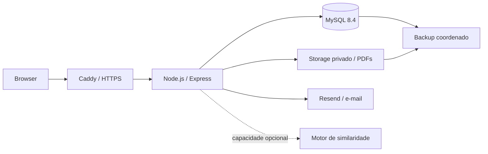

# Arquitetura

O navegador acessa páginas e API da mesma aplicação. Em staging/produção, Caddy recebe HTTPS
e encaminha ao Express. O Node consulta MySQL e lê/grava arquivos em volumes privados.
MySQL guarda metadados, não os bytes dos PDFs.

Em desenvolvimento, Node roda no host e acessa o MySQL Docker em `127.0.0.1:33307`.
Na stack completa, usa o serviço `db` na rede privada. Caddy não monta os volumes de PDFs.

## Responsabilidades

| Parte | Responsabilidade |
| --- | --- |
| Frontend estático | Navegação, formulários, apresentação e chamadas autenticadas à API |
| Routes/middlewares | Contrato HTTP, validação de entrada, sessão e autorização inicial |
| Controllers | Coordenar requisição/resposta e converter falhas em mensagens seguras |
| Models | SQL parametrizado, transações, vínculos e invariantes persistentes |
| Serviços | Regras compartilhadas, progresso, PDFs, storage, métricas e integrações |
| MySQL | Integridade relacional, unicidade, histórico e locks |
| Scripts operacionais | Migrations, seed explícito, deploy, backup, restore e verificações |

O runtime não executa migrations ou seeds automaticamente. Configuração crítica inválida
bloqueia inicialização. Escrita acadêmica revalida professor/estado da turma sob transação.
Filesystem e MySQL não compartilham transação distribuída: publicação recuperável,
compensação e reconciliação tratam falhas sem afirmar atomicidade total.

Continue em [backend](backend.md), [frontend](frontend.md) e [banco/storage](database.md).
