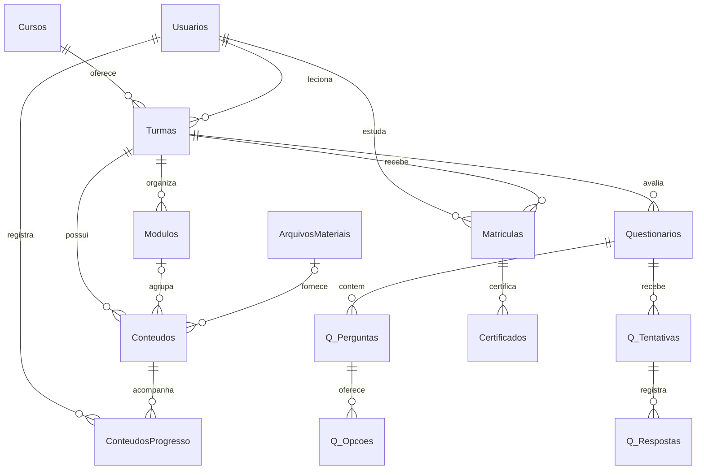

# Entidades e relacionamentos

O banco separa cadastro, oferta, aprendizagem e documentos. O schema canônico está em
[mysql/schema.sql](../../mysql/schema.sql); o contrato verificável está em
[scripts/schema-contract.json](../../scripts/schema-contract.json). Este guia resume as relações,
sem duplicar o SQL.

## Entidades principais

| Tabela | Papel e vínculos |
| --- | --- |
| `Usuarios` | Pessoa com CPF/e-mail únicos, tipo e versão de sessão |
| `EmailVerificacoes` | Confirmação de e-mail; o fluxo relaciona a identidade por e-mail |
| `PasswordResetTokens` | Hash de token, validade, uso e usuário |
| `Cursos` | Nome e carga horária da formação |
| `Turmas` | Oferta do curso e professor responsável |
| `Matriculas` | Par aluno/turma único, situação, nota opcional e ciclo atual |
| `Modulos` | Aula da turma, título e ordem |
| `Conteudos` | Item da turma, aula opcional, tipo e referência a PDF |
| `ConteudosProgresso` | Progresso único por aluno/conteúdo |
| `ArquivosMateriais` | UUID, tamanho/hash, estado e retenção do PDF privado |
| `Questionarios` | EXERCICIO/PROVA, aula opcional, ativo e designação da final |
| `Q_Perguntas`, `Q_Opcoes` | Enunciados, pontos, gabarito booleano e alternativas de múltipla escolha |
| `Q_AssociacaoItens`, `Q_AssociacaoGabaritos` | Itens dos dois lados e correspondências corretas |
| `Q_Tentativas` | Submissão, ciclo, pontuação e chave de idempotência |
| `Q_Respostas`, `Q_RespostaOpcoes`, `Q_RespostaAssociacoes` | Resposta por pergunta e detalhes de seleção ou associação |
| `Certificados` | Versão, situação, snapshot, hash, código e vínculo à matrícula |
| `ReplicacoesTurma` | Origem/destino, ator, chave e hash da operação |
| `AnalisesPlagio`, `AnalisesContextuais` | Histórico da integração opcional de similaridade |
| `environment_identity` | Marcador técnico do ambiente/banco |
| `schema_migrations` | Ledger técnico criado pelo runner, separado do DDL canônico |

## Relações simplificadas

O diagrama omite relações secundárias para manter a leitura. Vínculo aluno/turma de certificado
usa FK composta. `id_certificado_anterior` encadeia versões. Unicidade com coluna gerada
impede dois certificados ATIVO por aluno/turma. Outra constraint garante uma prova final por turma.

`Q_Tentativas` usa usuário + questionário + ciclo + chave de idempotência para evitar duplicação.
A rematrícula troca o ciclo sem apagar tentativas. Progresso atual de conteúdos é reiniciado
explicitamente na rematrícula. Pertencimento à mesma turma e autorização também são validados
na aplicação: FK isolada não resolve todas as regras acadêmicas.

## Evolução e verificação

Há 16 migrations versionadas nesta revisão, incluindo a evolução dos tipos de questão.
`schema_migrations` registra a evolução realmente aplicada; `environment_identity` identifica
o destino. Um schema parecido não autoriza scripts destrutivos de teste.

Use [migrations](migrations.md) para aplicar mudanças e validar tipos, índices, FKs e CHECKs.
