> **Histórico de engenharia.** Este registro preserva decisões e resultados da época; para desenvolver ou operar, use a [documentação vigente](../index.md).

# Arquitetura, fluxos e decisões

## Estilo real

Monólito web modular, com frontend multipágina estático e API HTTP JSON servidos pelo mesmo processo Express. O servidor usa CommonJS; o navegador usa módulos ES e manipulação direta do DOM, sem framework SPA, bundler ou renderização server-side de dados acadêmicos. MySQL é a persistência relacional; filesystem é a persistência dos PDFs. O motor de análise é um serviço externo opcional, não um microsserviço incluído no Compose desta plataforma.

Fluxo mais comum: `Route → validação/middleware → Controller → Model com SQL e regras → pool MySQL`. Fluxos de certificados e replicação usam `Controller → Service → Model/SQL → MySQL e/ou storage`. A replicação executa SQL diretamente no service. A autorização estrutural é compartilhada, mas controllers ainda resolvem ownership antes de vários models. Não há camada Repository independente, ORM, event bus ou unidade transacional comum ao banco e aos arquivos.

Na Sala Virtual, `getMinhaSala` e `getMeusCertificados` permanecem paralelos, mas são consolidados com `Promise.allSettled`: matrícula/turmas é o recurso crítico e certificados são secundários. Cada seção resolve loading/success/empty/error separadamente; falha secundária mantém as turmas e oferece retry local. `api.js` centraliza parse seguro de JSON/204 e mensagens HTTP, enquanto `private-pdf.js` converte 404/503/network em estados de UI antes de abrir bytes privados.

Fontes: `index.js`, `src/api/{routes,controllers,models,services}`, `src/config/database.js`, `src/public/js`, `package.json`.

## C4 — contexto

Diagramas usam flowchart Mermaid como representação equivalente aos níveis C4; não exigem extensão C4 do renderizador.

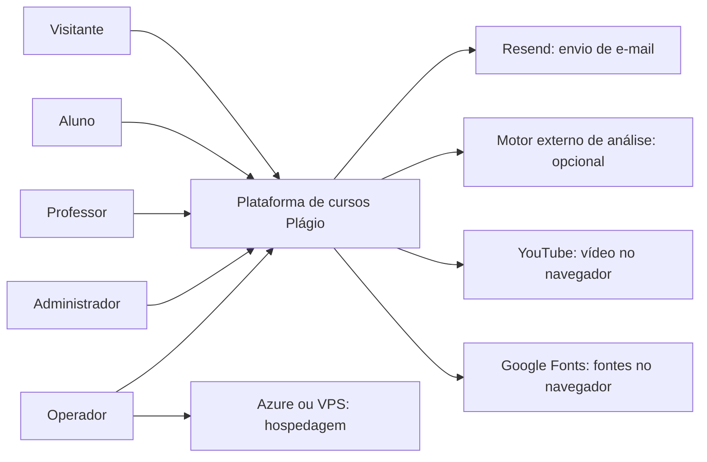

## C4 — containers

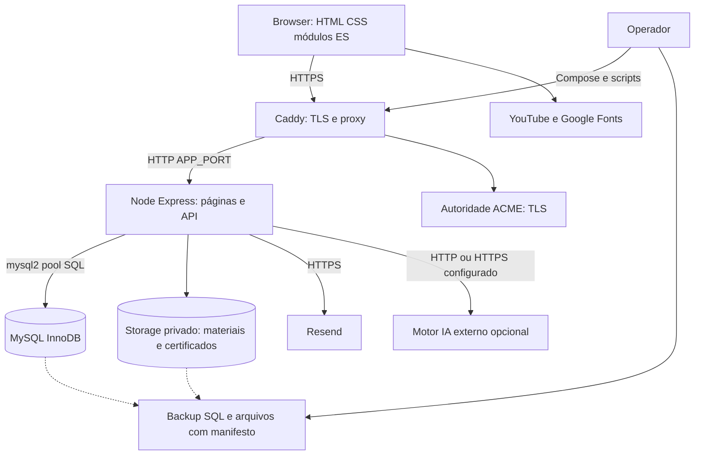

Node serve também os assets; Caddy não monta os volumes privados. A rede Docker permite saída (`internal: false`), mas app/db não publicam portas no host. Localmente, `npm start` pode servir HTTP sem Caddy.

## C4 — componentes do backend

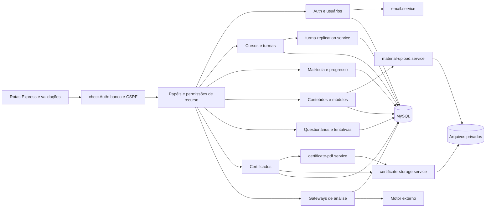

A seta IA→MySQL vale para resumo contextual/documento e comparação legada; incremental e indexado não persistem resultado local. Liveness, readiness e métricas ADMIN são componentes transversais pequenos; `requestContext` gera o UUID e `httpObservability` registra duração/status e counters in-memory. O wrapper do pool mede somente aquisições observáveis pela API pública do mysql2.

## Fluxos de ponta a ponta

**Cadastro e acesso:** `cadastro.js` verifica disponibilidade e faz uma única chamada autoritativa de cadastro. O backend normaliza o e-mail, grava ALUNO + `EmailVerificacoes` pendente em uma transação e só então chama `email.service`, sem manter transação SQL durante I/O externo. Falha do provedor mantém o cadastro e informa estado pendente recuperável. Reenvio e confirmação serializam a linha com `FOR UPDATE`; reenvio de conta confirmada é idempotente e não altera o estado. `auth.js` faz login e mantém usuário/CSRF em memória; o login só emite sessão quando existe verificação explícita com `verificado=1`.

**Aluno:** catálogo público → POST matrícula → minha-sala → conteúdos/módulos e metadados de avaliações → seleção por aula → INICIADO ao abrir → CONCLUIDO por ação explícita → questionário por tipo/ID → resultado e histórico. A aula agrega avaliações na sua apresentação; a matrícula só conta Conteudos. Aprovação é lançada separadamente pelo responsável. Datas/vagas/pré-requisitos não são gates encontrados.

**Professor:** lista própria → página da turma → cria módulo/conteúdo/PDF/questionário/pergunta → acompanha alunos/resultados → lança nota e situação → emite certificado de aprovado. Alteração estrutural em turma encerrada é bloqueada; lançamento de nota não tem bloqueio equivalente por status da turma. CRUD global de oferta pertence ao ADMIN.

**Admin:** usuários/cursos/turmas → gestão acadêmica de qualquer turma → replicação estrutural e revogação. A interface docente também admite ADMIN na página de gestão; não existe superusuário que ignore integridade ou assuma rotas exclusivas de ALUNO.

**Replicação:** resumo → nova configuração de turma + Idempotency-Key → transação → cópia e remapeamento de módulos/conteúdos/questionários/perguntas/opções → destino sem histórico pessoal. Materiais referenciam o mesmo ativo imutável. Alterar conteúdo de destino não modifica linha de origem; substituir PDF não sobrescreve ativo compartilhado.

**Certificado:** responsável escolhe matrícula aprovada → geração PDF com snapshot, QR e código → publicação privada e SHA-256 → registro único → aluno baixa bytes originais → terceiro consulta código ou envia bytes para validação. Revogação altera resposta pública, não reescreve o PDF. Código prova existência/status de registro; hash compara bytes; não é assinatura digital do emissor.

## Sequências críticas

### Login

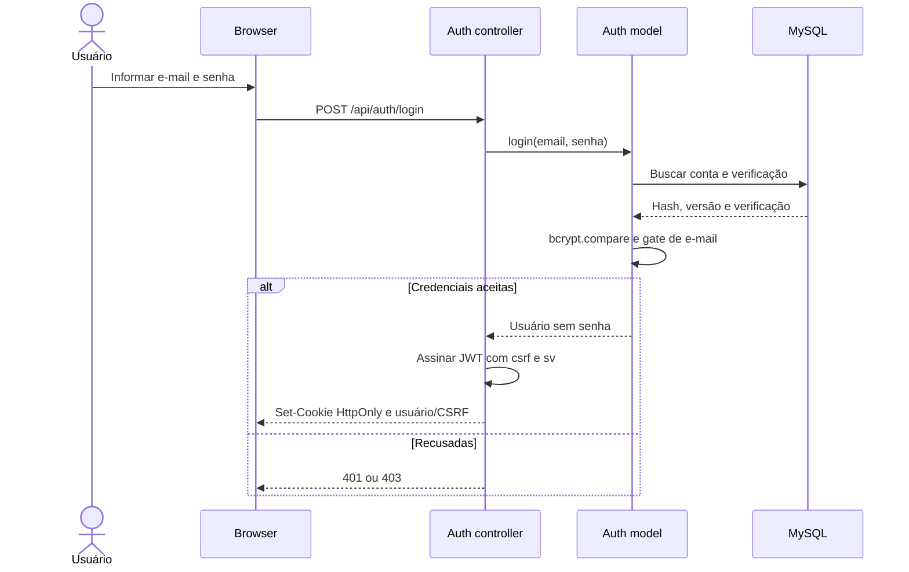

### Download de PDF protegido

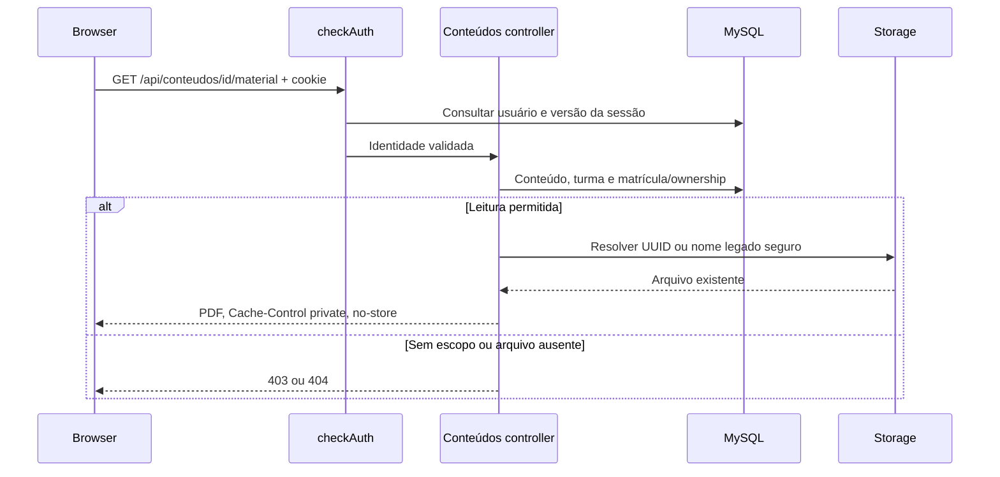

### Upload de material

```mermaid
sequenceDiagram
  participant B as Professor ou ADMIN
  participant C as Controller e checkAuth
  participant U as Material upload service
  participant D as MySQL
  participant F as Storage
  B->>C: POST multipart + cookie + CSRF
  C->>D: Autorizar turma e estado
  C->>U: Receber um arquivo
  U->>U: Buffer limitado, MIME, extensão e magic bytes
  U->>D: Trava de publicação por UUID
  U->>F: UUID.pending exclusivo, write, fsync, close
  U->>U: SHA-256 dos bytes finais
  C->>D: BEGIN, lock de turma e autorização final
  U->>F: Link final sem overwrite, unlink temp, fsync diretório
  C->>D: Inserir ativo e conteúdo
  alt Persistência aceita
    D-->>C: COMMIT
    C-->>B: 201 e URL protegida
  else Falha
    C->>D: ROLLBACK
    C->>F: Compensar novo arquivo se COMMIT não foi iniciado
    Note over C,F: COMMIT incerto preserva final; reconciliador classifica resíduos
    C-->>B: Erro HTTP
  end
```

### Submissão e correção

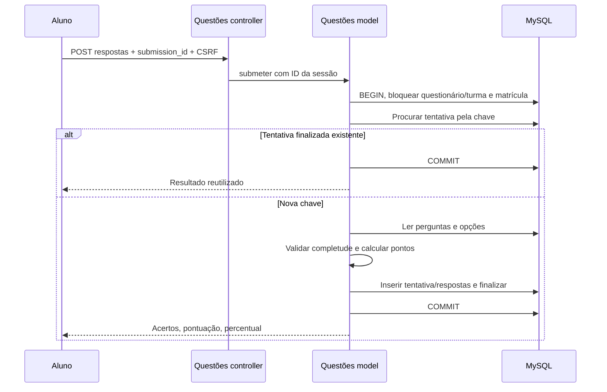

### Progresso

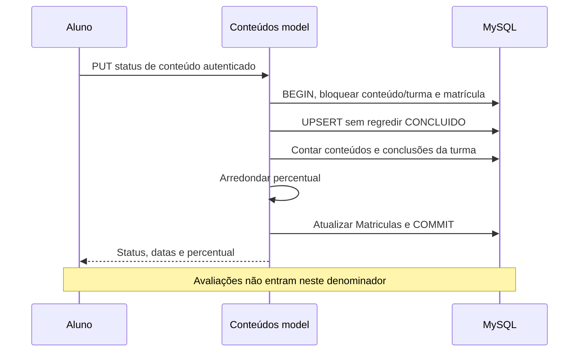

### Replicação

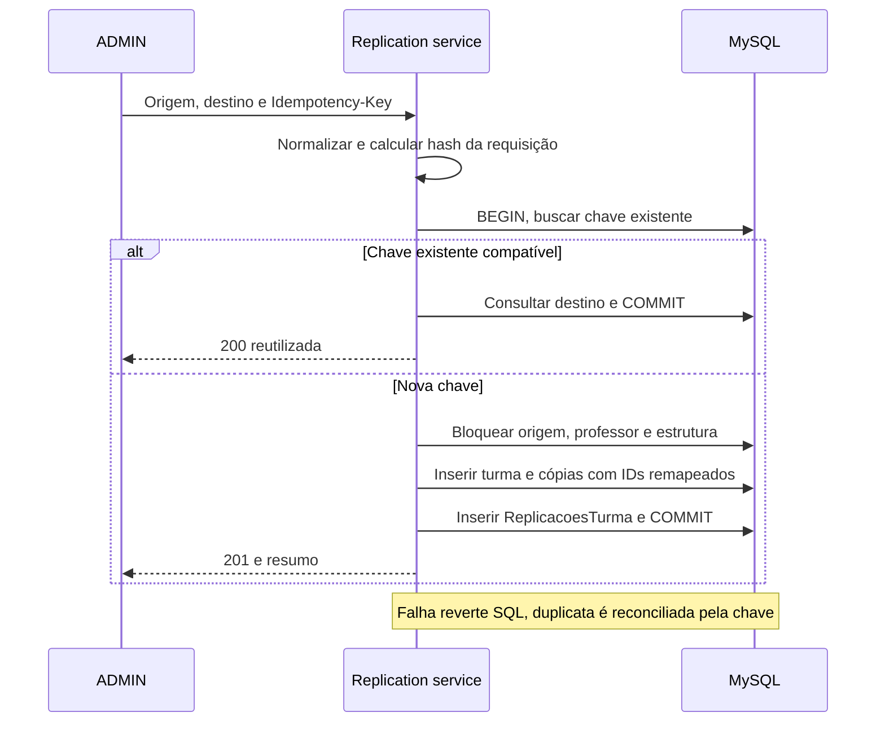

### Emissão

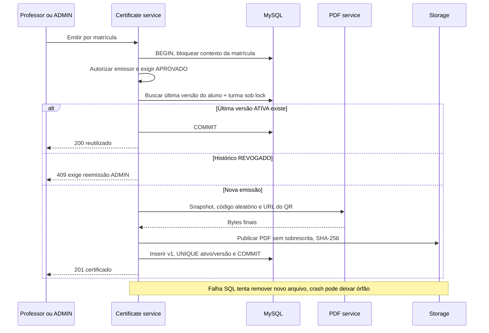

### Validação pública

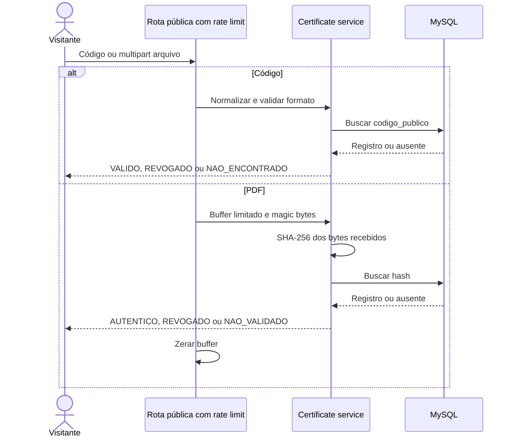

## Estados implementados

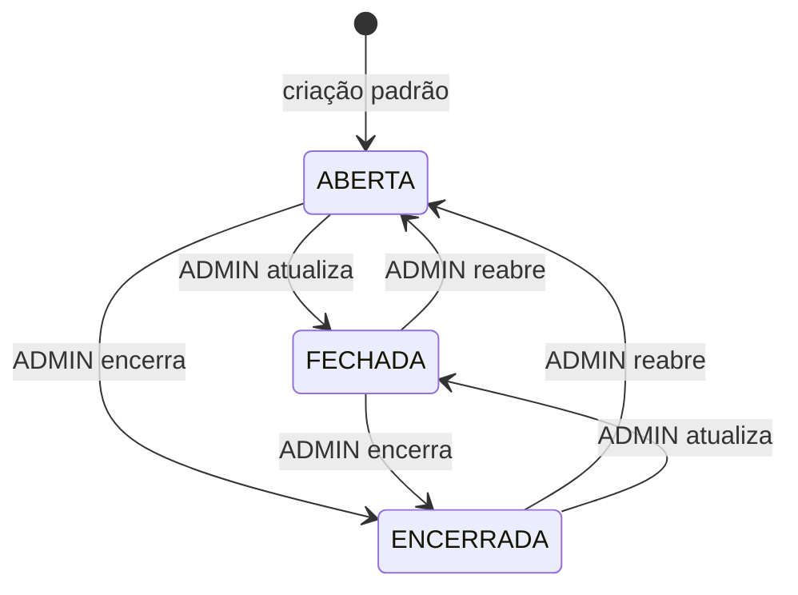

Criação/replicação também podem receber FECHADA ou ENCERRADA. Não há cron de transição por data. Conteúdos e submissões bloqueiam ENCERRADA, mas metadados de avaliações não; nota/situação e certificado seguem gates próprios.

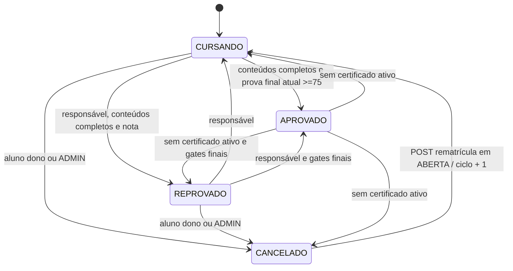

O model impõe a transição relevante: CANCELADO não sai pelo PATCH acadêmico, inclusive para responsável/ADMIN. O POST oficial do próprio aluno bloqueia primeiro a turma e depois a matrícula; somente ABERTA reativa, incrementa o ciclo uma vez, reinicia nota/progresso atual e preserva tentativas. Requisição concorrente que observa o vínculo já CURSANDO recebe 409. APROVADO/REPROVADO preservam as transições anteriores que não conflitam com essa regra.

```mermaid
sequenceDiagram
  actor A as Aluno
  participant API as POST /matriculas
  participant DB as MySQL
  A->>API: rematricular na turma
  API->>DB: BEGIN; lock turma
  API->>DB: exigir ABERTA; lock matrícula
  API->>DB: apagar progresso atual de conteúdo
  API->>DB: CANCELADO → CURSANDO; ciclo + 1; nota NULL
  API->>DB: COMMIT
  API-->>A: 200 com novo ciclo
  Note over API,DB: tentativas/respostas/certificados não são alterados
```

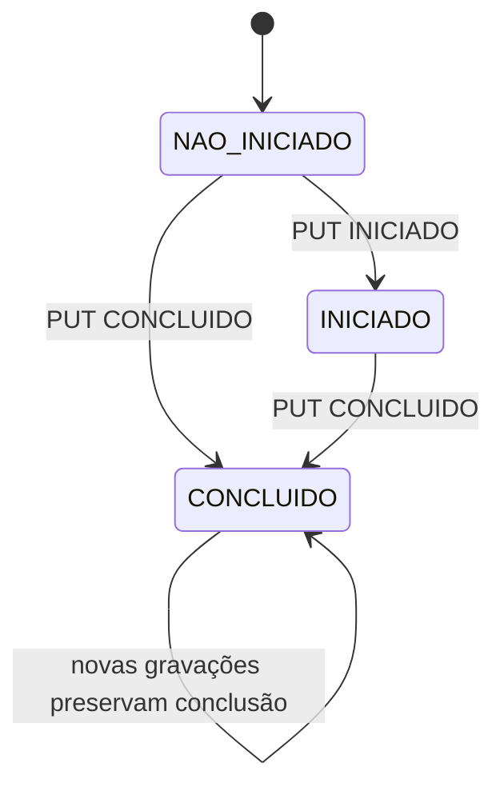

NAO_INICIADO frequentemente é ausência de linha transformada por COALESCE. Reativação de matrícula exclui progresso; não é regressão pelo endpoint do conteúdo.

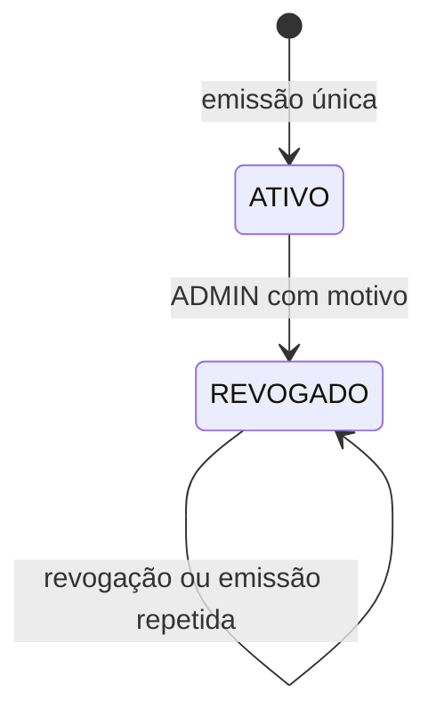

Certificado revogado não retorna a ATIVO. Questionário alterna ativo/inativo por PATCH enquanto turma editável; tentativas são criadas/finalizadas na mesma transação, sem sessão de prova aberta persistente. Token de recuperação transita de válido para usado/expirado por campos de data; verificação de e-mail pode voltar a pendente ao reenviar código. Arquivo material transita de ATIVO para RETIDO ao perder a última referência; collector explícito confirma PURGANDO antes de unlink e PURGADO depois, preservando metadata e datas.

## Decisões arquiteturais observadas

| Decisão | Contexto e motivação | Consequências e trade-offs |
| --- | --- | --- |
| MySQL como fonte de verdade | Papel e versão consultados em cada autenticação; motivação evidenciada em comentário de checkAuth | Revogação imediata e integridade relacional; autenticação depende do banco e acrescenta consulta. |
| Migrations forward-only com ledger | `schema_migrations` registra versão/arquivo/SHA-256; `GET_LOCK` serializa runners; baseline legado é explícito após validação | Migration aplicada é imutável. Falha DDL pode ser parcial e exige diagnóstico, migration corretiva ou restore; não há falsa promessa de down/rollback automático. |
| Cookie JWT + CSRF | Implementação substitui necessidade de token persistido no navegador; motivação inferida: reduzir exposição a JavaScript | HttpOnly e revogação por versão; Bearer permanece compatível e precisa ser considerado na auditoria. |
| Monólito multipágina | HTML e API no mesmo Express; motivação inferida: simplicidade para escopo atual | Deploy único e mesma origem; UI e backend evoluem juntos, sem compilação de frontend. |
| SQL nos models | Sem ORM/repository; motivação não documentada | Controle de locks e queries; regras e persistência ficam acopladas e repetidas. |
| PDFs privados em disco | Config rejeita public; motivação evidenciada no código de storage | Downloads autorizados e volumes simples; backup conjunto e escala horizontal exigem coordenação. |

## Backup e recuperação — Goal 08

O ponto de recuperação combina snapshot lógico MySQL e cópia dos arquivos enquanto o app está
parado. O reconciliador APPLY usa a mesma trava advisory do backup, eliminando purge concorrente;
publicadores normais ficam ausentes porque o único serviço writer está suspenso. Após a cópia, a
aplicação é retomada e validação/hash/upload ocorrem fora da janela de indisponibilidade.

O conjunto local imutável contém dump, metadata, ambos os namespaces, manifesto v1, checksums e
marker local. O Azure Blob só se torna selecionável quando existe completion marker posterior ao
upload e re-download com SHA igual. Restore faz o caminho inverso em banco limpo e storages
substituídos, seguido de contrato de schema, comparação de inventário, reconciliador e health.
Detalhes e comandos estão no [runbook](history/BACKUP_RESTORE_RUNBOOK.md).
| Ativos imutáveis compartilhados | Substituição cria novo arquivo e replicação mantém referência; motivação evidenciada pelos testes PDF | Economia de cópia, independência lógica; retenção/orfandade aumenta volume. |
| Deep copy relacional | Sem dados pessoais na estrutura copiada; intenção evidenciada no service/teste | Turmas independentes; custo cresce com estrutura e transação mantém locks. |
| Progresso derivado | Consultas calculam contagens; motivação inferida: evitar aceitar percentual arbitrário | Consistência nas leituras; consultas repetidas e coluna armazenada redundante. |
| Nota final manual | Submissão não atualiza matrícula; motivação não documentada | Autonomia docente, sem política fixa; UX deve distinguir nota de tentativa e final. |
| Certificado final imutável | Hash dos bytes e snapshot; motivação evidenciada em service/testes | Validação exata e histórico estável; recuperação precisa dos bytes, não só banco. |
| Caddy e Compose | Runbook de VPS e configuração TLS; motivação inferida: operação compacta | Portabilidade entre hosts; single host sem HA. |
| Detector por flag | Capability experimental e bloqueio de gateway; motivação evidenciada em SECURITY_MVP | Formação opera sem IA; recurso depende de implantação separada. |

As motivações inferidas não são ADRs históricos aprovados. Estas decisões descrevem o código; propostas futuras estão separadas em [riscos](09-risks-technical-debt.md).

### Goal 03 — sequência da reemissão

```mermaid
sequenceDiagram
  actor A as ADMIN
  participant S as Certificate service
  participant D as MySQL
  participant F as PDF e storage privado
  A->>S: POST versão-alvo/reemitir, motivo
  S->>S: Autorizar ADMIN e validar motivo
  S->>D: Resolver matrícula fora da transação
  S->>D: BEGIN e bloquear contexto matrícula/turma
  S->>D: Ler última versão com FOR UPDATE
  S->>S: Rejeitar alvo substituído e revalidar Goal 02
  S->>F: Novo snapshot, código, QR, PDF, SHA e UUID
  F-->>S: Arquivo final durável, sem sobrescrita
  S->>D: Revogar anterior se ATIVA; INSERT v+1
  S->>D: COMMIT
  S-->>A: 201 nova versão
  Note over S,D: Rollback desfaz revogação e INSERT juntos
  Note over S,F: Compensação remove apenas o novo arquivo; COMMIT incerto preserva arquivo
```

Não há transação distribuída. Crash entre publicação do PDF e commit pode deixar órfão; perda da resposta do COMMIT exige verificar histórico/banco, sem apagar o arquivo potencialmente confirmado. A versão-alvo funciona como precondição persistente contra retry/concorrência; não foi introduzido Idempotency-Key, pois 409 explícito ao mesmo alvo já impede nova substituição acidental. O padrão existente de chaves de replicação/tentativa cobre operações sem essa precondição natural.


## Atualização — Goal 06

A primitiva `academic-access.service.js` usa a conexão da mutação. Descoberta de IDs precede BEGIN; autorização ocorre sob lock de Turmas e cada vínculo é relido. Ordem: turma → recurso/descendentes → histórico/dependências → escrita. Progresso, tentativas, matrícula e emissão de certificado foram alinhados ao lock da turma; GETs não ganham locks exclusivos.

Contrato, inventário e evidências: [GOAL_06_ATOMIC_ACADEMIC_AUTHORIZATION.md](goals/GOAL_06_ATOMIC_ACADEMIC_AUTHORIZATION.md).

## Storage e reconciliação — Goal 07

A publicação privada usa temp exclusivo no volume, fsync e link/unlink sem overwrite antes de COMMIT. Advisory lock por UUID coordena escrita e collector; autorização acadêmica continua na transação do Goal 06. COMMIT incerto preserva os bytes para reconciliação. [Contrato, inventário e evidências](goals/GOAL_07_STORAGE_DATABASE_INTEGRITY.md).
