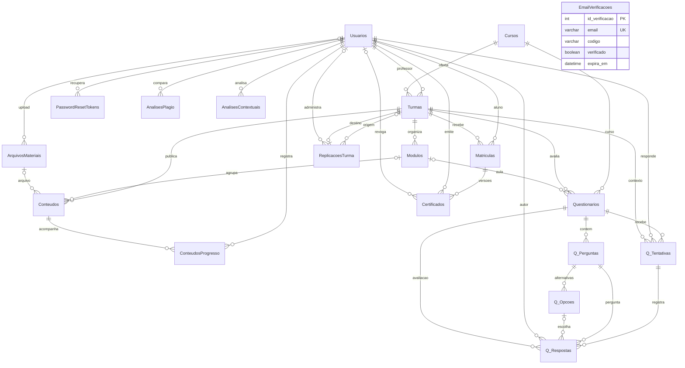

> **Histórico de engenharia.** Este registro preserva decisões e resultados da época; para desenvolver ou operar, use a [documentação vigente](../index.md).

# Modelo relacional e dicionário de dados

## Fonte e confirmação

`mysql/schema.sql` contém 20 tabelas InnoDB, charset utf8mb4 e collation utf8mb4_unicode_ci; campos técnicos usam `ascii_bin` quando comparação binária é necessária. Doze migrations históricas complementam o schema existente. O runner acrescenta `schema_migrations` como 21ª tabela técnica. Não há criação/seleção de banco no DDL canônico.

Em 2026-09-06, consulta somente leitura ao MySQL de testes confirmou versão `8.0.46-0ubuntu0.24.04.3`, 19 tabelas, 152 colunas e aprovação de `assertCanonicalSchema`. Foram consultados metadados, sem exportar dados pessoais. Em 2026-09-07, a reconsulta retornou ECONNREFUSED: a constatação anterior é datada, não prova disponibilidade atual. A configuração local de desenvolvimento retornou ER_DBACCESS_DENIED_ERROR em 2026-09-06. Schema efetivo remoto de staging/produção não foi inspecionado nesta baseline.

Desde o Goal 11A, o verificador compara o contrato versionado completo: tabelas/engine/collation, colunas e suas definições, PK/UNIQUE/índices, FK e ações referenciais, CHECKs e tabelas inesperadas. O catálogo abaixo deriva do DDL lido diretamente. `site_cursos_db.mwb` e `mysql/estruturaprojeto` são artefatos auxiliares/históricos e não sobrepõem o SQL canônico.

## Catálogo de tabelas

PKs numéricas são AUTO_INCREMENT. Nos índices declarados abaixo, `uk_` identifica UNIQUE e `idx_` identifica índice não único; índices auxiliares criados implicitamente pelo MySQL para FKs não são enumerados. As regras multi-entidade devem ser lidas junto do backend.

### Usuarios

**Responsabilidade:** Identidade, perfil e versão de sessão. **PK:** `id_usuario`.

**Índices:** `uk_usuarios_cpf` (`cpf`); `uk_usuarios_email` (`email`).

**Relacionamentos:** sem FK declarada.

### PasswordResetTokens

**Responsabilidade:** Credenciais temporárias de recuperação, somente hash. **PK:** `id_token`.

**Índices:** `uk_password_reset_hash` (`token_hash`); `idx_password_reset_usuario_estado` (`id_usuario`, `usado_em`, `expira_em`).

**Relacionamentos:** `id_usuario` → `Usuarios` (`id_usuario`), DELETE CASCADE.

### EmailVerificacoes

**Responsabilidade:** Confirmação de endereço por código; vínculo por e-mail, sem FK. **PK:** `id_verificacao`.

**Índices:** `uk_email_verificacao` (`email`).

**Relacionamentos:** sem FK declarada.

### ArquivosMateriais

**Responsabilidade:** Ativos privados de material reutilizáveis por conteúdos. **PK:** `id_arquivo_material`.

**Índices:** `uk_arquivo_material_storage` (`storage_name`); `idx_arquivo_material_sha256` (`sha256`); `idx_arquivo_material_usuario` (`id_usuario_upload`).

**Relacionamentos:** `id_usuario_upload` → `Usuarios` (`id_usuario`), DELETE SET NULL.

### Cursos

**Responsabilidade:** Oferta formativa e carga horária. **PK:** `id_curso`.

**Índices:** `uk_cursos_nome` (`nome_curso`).

**Relacionamentos:** sem FK declarada.

### Turmas

**Responsabilidade:** Edição de curso, professor responsável e disponibilidade. **PK:** `id_turma`.

**Índices:** `uk_turmas_nome` (`nome_turma`); `idx_turmas_curso` (`id_curso`); `idx_turmas_professor` (`id_professor`).

**Relacionamentos:** `id_curso` → `Cursos` (`id_curso`), DELETE RESTRICT; `id_professor` → `Usuarios` (`id_usuario`), DELETE RESTRICT.

### ReplicacoesTurma

**Responsabilidade:** Proveniência e idempotência de cópia estrutural. **PK:** `id_replicacao`.

**Índices:** `uk_replicacao_chave` (`chave_idempotencia`); `uk_replicacao_destino` (`id_turma_destino`); `idx_replicacao_origem` (`id_turma_origem`); `idx_replicacao_admin` (`id_usuario_admin`).

**Relacionamentos:** `id_turma_origem` → `Turmas` (`id_turma`), DELETE SET NULL; `id_turma_destino` → `Turmas` (`id_turma`), DELETE CASCADE; `id_usuario_admin` → `Usuarios` (`id_usuario`), DELETE SET NULL.

### Matriculas

**Responsabilidade:** Vínculo aluno/turma, situação acadêmica e número monotônico do ciclo vigente em `ciclo_atual` (inicial 1). **PK:** `id_matricula`.

**Índices:** `uk_aluno_turma` (`id_aluno`, `id_turma`); `idx_matriculas_turma` (`id_turma`).

**Relacionamentos:** `id_aluno` → `Usuarios` (`id_usuario`), DELETE CASCADE; `id_turma` → `Turmas` (`id_turma`), DELETE CASCADE.

**CHECK:** `chk_matriculas_nota`, `chk_matriculas_progresso`, `chk_matriculas_ciclo` (`ciclo_atual >= 1`).

### Certificados

**Responsabilidade:** Snapshot acadêmico, identidade pública e referência ao PDF final. **PK:** `id_certificado`.

**Índices:** `uk_certificado_ativo` (`id_aluno`, `id_turma`, `ativo_unico`); `uk_certificado_versao` (`id_aluno`, `id_turma`, `versao`); `uk_certificado_anterior` (`id_certificado_anterior`); `uk_certificado_codigo_publico` (`codigo_publico`); `uk_certificado_storage_name` (`storage_name`); `idx_certificado_sha256` (`sha256`).

**Relacionamentos:** `id_aluno`, `id_turma` → `Matriculas` (`id_aluno`, `id_turma`), DELETE RESTRICT; `id_usuario_emissor` → `Usuarios` (`id_usuario`), DELETE RESTRICT; `id_usuario_revogador` → `Usuarios` (`id_usuario`), DELETE RESTRICT.

**CHECK:** `chk_certificado_carga_horaria`, `chk_certificado_revogacao`, `chk_certificado_versao` (>=1), `chk_certificado_reemissao` (lineage, motivo 3–500, data, reemissor e snapshot obrigatórios em v>1). `id_certificado_anterior` referencia Certificados; `id_usuario_reemissor` referencia Usuarios, ambos com DELETE RESTRICT.

### Questionarios

**Responsabilidade:** Avaliação objetiva por curso/turma e aula opcional. **PK:** `id_questionario`.

**Índices:** `uk_questionario_turma_tipo_titulo` (`id_turma`, `tipo`, `titulo`); `idx_questionarios_curso` (`id_curso`).

**Relacionamentos:** `id_curso` → `Cursos` (`id_curso`), DELETE CASCADE; `id_turma` → `Turmas` (`id_turma`), DELETE CASCADE.

O ALTER posterior adiciona `fk_questionario_modulo`: id_modulo → Modulos, ON DELETE RESTRICT. Consistência curso/turma/aula é verificada na aplicação ao criar; não há FK composta para garantir alinhamento.

### Q_Perguntas

**Responsabilidade:** Enunciados ordenados e pesos. **PK:** `id_pergunta`.

**Índices:** `uk_pergunta_questionario_ordem` (`id_questionario`, `ordem`).

**Relacionamentos:** `id_questionario` → `Questionarios` (`id_questionario`), DELETE CASCADE.

### Q_Opcoes

**Responsabilidade:** Alternativas e gabarito. **PK:** `id_opcao`.

**Índices:** `uk_opcao_pergunta_ordem` (`id_pergunta`, `ordem`).

**Relacionamentos:** `id_pergunta` → `Q_Perguntas` (`id_pergunta`), DELETE CASCADE.

### Q_Tentativas

**Responsabilidade:** Resultado agregado de uma submissão idempotente, preservado no ciclo explícito `ciclo_matricula`. **PK:** `id_tentativa`.

**Índices:** `uk_tentativa_idempotente` (`id_usuario`, `id_questionario`, `ciclo_matricula`, `chave_idempotencia`); `idx_tentativas_aluno_questionario` (`id_usuario`, `id_questionario`); `idx_tentativas_ciclo_atual` (`id_usuario`, `id_turma`, `ciclo_matricula`, `id_questionario`, `finalizada_em`); `idx_tentativas_turma` (`id_turma`).

**Relacionamentos:** `id_questionario` → `Questionarios` (`id_questionario`), DELETE CASCADE; `id_usuario` → `Usuarios` (`id_usuario`), DELETE CASCADE; `id_turma` → `Turmas` (`id_turma`), DELETE CASCADE.

**CHECK:** `chk_tentativas_percentual`, `chk_tentativas_ciclo` (`ciclo_matricula >= 1`).

### Q_Respostas

**Responsabilidade:** Escolhas e correção por pergunta/tentativa. **PK:** `id_resposta`.

**Índices:** `uk_resposta_tentativa_pergunta` (`id_tentativa`, `id_pergunta`); `idx_respostas_usuario` (`id_usuario`); `idx_respostas_questionario` (`id_questionario`); `idx_respostas_opcao` (`resposta_opcao`).

**Relacionamentos:** `id_pergunta` → `Q_Perguntas` (`id_pergunta`), DELETE CASCADE; `id_usuario` → `Usuarios` (`id_usuario`), DELETE CASCADE; `id_questionario` → `Questionarios` (`id_questionario`), DELETE CASCADE; `id_tentativa` → `Q_Tentativas` (`id_tentativa`), DELETE CASCADE; `resposta_opcao` → `Q_Opcoes` (`id_opcao`), DELETE SET NULL.

### Modulos

**Responsabilidade:** Aulas ordenadas de uma turma. **PK:** `id_modulo`.

**Índices:** `uk_modulo_turma_ordem` (`id_turma`, `ordem`).

**Relacionamentos:** `id_turma` → `Turmas` (`id_turma`), DELETE CASCADE.

### Conteudos

**Responsabilidade:** Material educacional, aula opcional e referência a arquivo/URL/texto. **PK:** `id_conteudo`.

**Índices:** `uk_conteudo_turma_ordem` (`id_turma`, `ordem`); `idx_conteudo_modulo` (`id_modulo`); `idx_conteudo_arquivo_material` (`id_arquivo_material`).

**Relacionamentos:** `id_turma` → `Turmas` (`id_turma`), DELETE CASCADE; `id_modulo` → `Modulos` (`id_modulo`), DELETE SET NULL; `id_arquivo_material` → `ArquivosMateriais` (`id_arquivo_material`), DELETE RESTRICT.

### ConteudosProgresso

**Responsabilidade:** Estado individual por aluno/conteúdo. **PK:** `id_progresso`.

**Índices:** `uk_aluno_conteudo` (`id_aluno`, `id_conteudo`).

**Relacionamentos:** `id_aluno` → `Usuarios` (`id_usuario`), DELETE CASCADE; `id_conteudo` → `Conteudos` (`id_conteudo`), DELETE CASCADE.

### AnalisesPlagio

**Responsabilidade:** Histórico legado com texto suspeito e score/fontes. **PK:** `id`.

**Índices:** `idx_analises_usuario` (`usuario_id`).

**Relacionamentos:** `usuario_id` → `Usuarios` (`id_usuario`), DELETE CASCADE.

### AnalisesContextuais

**Responsabilidade:** Resumo e parâmetros da análise sem documento completo. **PK:** `id`.

**Índices:** `idx_analises_contextuais_usuario_criado` (`id_usuario`, `criado_em`).

**Relacionamentos:** sem FK declarada.

## ER — relações implementadas

A relação Certificados–Matriculas usa FK composta `(id_aluno,id_turma)`, não `id_matricula`. Linhas de Usuarios nos papéis de aluno/professor/emissor apontam para a mesma tabela. O diagrama resume as relações do domínio; o catálogo acima preserva relações adicionais de auditoria.

EmailVerificacoes não tem FK para Usuarios: a associação é consulta por string de e-mail. Não há tabela Professores, Alunos, Aulas ou Provas separada; são papéis, Modulos e tipos de Questionarios.

## Dicionário semântico resumido

| Campo | Semântica e domínio | Garantia/limitação |
| --- | --- | --- |
| Usuarios.tipo | ALUNO, PROFESSOR, ADMIN | ENUM; ownership é backend. |
| Usuarios.cpf | 11 caracteres, dado pessoal | UNIQUE; rota exige dígitos, não valida dígitos verificadores. |
| Usuarios.email | Identidade de login e entrega | UNIQUE com collation sem distinção de caixa; cadastro, login, reenvio e confirmação usam trim + lowercase. |
| Usuarios.senha | Hash bcrypt | Não retornar em consultas públicas/privadas usuais. |
| Usuarios.versao_sessao | Contador de revogação global | JWT sv deve coincidir; incrementado no logout/troca/reset. |
| EmailVerificacoes.codigo/verificado/expira_em | Código de seis dígitos, confirmação e expiração | Código persiste legível; cadastro cria pendente atomicamente; reenvio só atualiza pendente. Tentativas são limitadas na rota, em memória por processo. |
| PasswordResetTokens.token_hash/usado_em/expira_em | SHA-256, consumo e prazo | UNIQUE hash, FK e locks no reset. |
| Cursos.carga_horaria | Horas da formação | Backend exige inteiro positivo; sem CHECK próprio no curso. |
| Turmas.status | ABERTA, FECHADA, ENCERRADA | ENUM; atualização manual por ADMIN, sem agendamento. |
| Turmas.data_inicio/data_fim | Período nominal | Fim nullable; backend valida ordenação, não vincula automaticamente acesso. |
| Matriculas.status_aprovacao | CURSANDO, APROVADO, REPROVADO, CANCELADO | Cancelamento lógico; nota manual; CURSANDO→APROVADO por Teste Final >=75, sem exigir conteúdo completo; REPROVADO manual. |
| Matriculas.nota_final | DECIMAL(5,2), NULL ou 0–10 | CHECK; percentual da prova não é nota final. |
| Matriculas.progresso_percentual | TINYINT 0–100 armazenado | CHECK; consultas centrais derivam novo percentual de ConteudosProgresso. |
| Modulos.ordem | Ordem da aula dentro da turma | UNIQUE turma+ordem; número exibido é posição ordenada, não ID. |
| Conteudos.tipo | VIDEO, TEXTO, PDF, LINK, ATIVIDADE | ENUM; cada tipo tem renderização, não fluxo de entrega de tarefa. |
| Conteudos.id_modulo | Aula opcional | Backend valida mesma turma; DELETE FK SET NULL, embora API bloqueie exclusão de aula ocupada. |
| Conteudos.url/corpo | URL restrita ou texto do material | corpo MEDIUMTEXT não autoriza HTML executável; UI usa texto. |
| Conteudos.id_arquivo_material | Referência ao ativo privado | FK RESTRICT; PDF legado pode usar url sem ativo. |
| Conteudos.duracao_minutos | Duração estimada, nullable | Não registra tempo efetivo de estudo. |
| Conteudos.ordem | Ordem global de conteúdos na turma | UNIQUE turma+ordem; avaliação tem ordenação independente. |
| ConteudosProgresso.status | NAO_INICIADO, INICIADO, CONCLUIDO | Ausência de registro também significa não iniciado; PUT não aceita regressão. |
| Matriculas.ciclo_atual | Inteiro >=1 | Identifica o ciclo acadêmico vigente; incrementa apenas na rematrícula oficial. |
| Questionarios.tipo/ativo | PROVA ou EXERCICIO; disponibilidade | Teste Final permite uma tentativa finalizada por aluno+turma; outras avaliações mantêm retries. |
| Questionarios.id_curso/id_turma/id_modulo | Escopo redundante e aula opcional | FK individuais não garantem coerência entre si; ver risco de troca de curso da turma. |
| Q_Perguntas.tipo_pergunta | MULTIPLA_ESCOLHA, VERDADEIRO_FALSO, RESPOSTA_CURTA | Último é legado e bloqueado no fluxo atual. |
| Q_Perguntas.pontos | Peso DECIMAL(6,2), padrão 1 | Rota aceita >0 até 1000, sem CHECK correspondente. |
| Q_Opcoes.correta | Gabarito booleano | Exatamente uma opção correta é regra do backend, sem índice condicional/CHECK. |
| Q_Tentativas.pontuacao/percentual/acertos | Resultado da submissão | Percentual 0–100 com CHECK; pontuação ponderada e acertos são diferentes. |
| Q_Tentativas.chave_idempotencia/ciclo_matricula | UUID e ciclo explícito | UNIQUE por ciclo mantém idempotência técnica; Teste Final também aplica tentativa única por aluno+turma na camada de aplicação. |
| Q_Respostas.resposta_opcao/resposta_texto | Opção escolhida ou campo textual legado | Rota atual só recebe id_opcao; texto não é fluxo suportado. |
| ArquivosMateriais.storage_name/original_name | UUID.pdf e nome de apresentação | Nome original nunca compõe caminho interno. |
| ArquivosMateriais.sha256/size_bytes/status | Integridade, tamanho e ATIVO/RETIDO/PURGANDO/PURGADO | Hash não é UNIQUE; retido_em e purgado_em auditam retenção e purge (migration 011). |
| Certificados.codigo_publico | Código aleatório de 128 bits formatado | UNIQUE; não contém ID sequencial do aluno. |
| Certificados.aluno_nome/curso_nome/turma_nome/carga_horaria | Snapshot na emissão | Mudança posterior do cadastro não reescreve documento. Novas versões também persistem CPF e dados utilizados em snapshot_json privado. Legados permanecem com snapshot_json NULL; CPF histórico continua apenas nos bytes originais. |
| Certificados.status/revogado_em/id_usuario_revogador/motivo_revogacao | ATIVO ou REVOGADO e trilha de revogação | CHECK obriga conjunto coerente de nulidade; API não reativa. |
| Certificados.sha256/storage_name/tamanho_bytes | Integridade dos bytes finais e localização | Storage UNIQUE; hash indexado não único; sem regeneração transparente. |
| ReplicacoesTurma.chave_idempotencia/requisicao_hash | Identidade e conteúdo normalizado da solicitação | Chave global única; SHA-256 não inclui identidade do admin. |
| AnalisesPlagio.trecho_texto/fontes_encontradas | Texto suspeito e JSON de fontes | Retenção local real no fluxo legado. |
| AnalisesContextuais.parametros_json/gravidade_maxima/status | Parâmetros e resumo | Gravidade INFORMATIVA/BAIXA/MEDIA/ALTA; status VARCHAR, não máquina de estados no banco. |

## Migrations e integridade distribuída

| Migration | Mudança |
| --- | --- |
| 001 | versao_sessao e PasswordResetTokens |
| 002 | Chave idempotente de tentativa, backfill UUID e CHECK de nota/progresso/percentual |
| 003 | ReplicacoesTurma |
| 004 | Hash da requisição de replicação; backfill histórico com hash sintético |
| 005 | ArquivosMateriais e FK no conteúdo |
| 006 | Certificados, unicidade, FK composta e CHECK |
| 007 | Questionários vinculados à aula e ordem |
| 008 | Designação estrutural e unicidade da prova final por turma |
| 009 | Versões de certificados, snapshot privado, lineage e UNIQUE de único ATIVO; preflight de legados |

`scripts/migrate_database.js` descobre a sequência determinística, obtém advisory lock MySQL e compara o SHA-256 dos bytes com `schema_migrations`. Executa apenas pendentes e registra uma versão somente após sucesso. DDL não constitui transação reversível conjunta: falha pode deixar alteração parcial, nunca é registrada e bloqueia as seguintes. A política é forward-only. Banco povoado sem ledger exige baseline explícito 001–011 após validação completa; a 012 continua pendente normal. Detalhes em [DATABASE_MIGRATIONS.md](history/DATABASE_MIGRATIONS.md).

| Regra | Frontend | Backend | Banco |
| --- | --- | --- | --- |
| Papel e ownership | Esconde/desabilita ações | Fonte de autorização | ENUM/FK não garantem papel do professor/aluno |
| Unicidade de matrícula/certificado | Evita duplicação | Lock do contexto e versão-alvo | UNIQUE matrícula, versão e coluna gerada de ATIVO |
| Pertencimento de aula à turma | Select de aulas | Valida ID + turma | FK simples só garante existência |
| Nota 0–10/progresso 0–100 | Campos/feedback | Validação e cálculo | CHECK de faixa |
| Gate do Teste Final e aprovação | Progresso visual e estado/resultados | 80% dos conteúdos abre; resultado final >=75 aprova | Não há CHECK acadêmico entre tentativa, progresso e status |
| Gabarito único | Criação guiada | Validações e updates transacionais | Sem garantia de exatamente uma correta |
| Preservar histórico | Desabilita algumas ações | Bloqueios em models | Várias FK CASCADE permitiriam exclusão por SQL direto |
| Material seguro | Validação preliminar | MIME/extensão/bytes/caminho | Apenas metadados/FK, não arquivo físico |
| Configuração de e-mail | Fluxo pede confirmação | Registro separado, login permissivo se ausente | Sem FK entre verificação e conta |

Acesso SQL administrativo pode contornar várias regras de aplicação. Alterar id_curso de Turmas não sincroniza id_curso de Questionarios; ambas as FK continuam válidas, mas semanticamente divergentes. Certificados ativos não congelam toda a estrutura acadêmica. Essas limitações estão registradas como risco, sem mudança de código.

## Goal 02 consolidado — prova final explícita

Migration idempotente `008_prova_final.sql`: `Questionarios.prova_final TINYINT(1) NULL DEFAULT NULL`. Valor 1 identifica final; NULL representa avaliação comum. CHECK permite 1 somente em tipo PROVA. UNIQUE `uk_prova_final_turma(id_turma, prova_final)` permite várias avaliações NULL e somente uma final por turma. Não há backfill por título/ID/ordem. Professor/ADMIN deve designar uma prova sem histórico ou criar uma final; alteração de designação com tentativas é recusada. Replicação copia a marcação, sem copiar progresso/tentativas.

`Matriculas.nota_final` continua nullable 0–10, manual; não é percentual da prova nem pré-condição para APROVADO. `Q_Tentativas.percentual` continua DECIMAL com duas casas; final usa truncamento conservador para evitar cruzar 75 por arredondamento. Tentativa finalizada >=75 no Teste Final constitui a aprovação, sem exigir conclusão integral. A aplicação limita a uma tentativa finalizada por aluno+turma; schema permanece inalterado. Certificado inicia automaticamente após aprovação.

### Migration 009 — versões de certificado

Um único ALTER atômico MySQL 8 adiciona `versao DEFAULT 1`, predecessor, motivo/data/reemissor, `snapshot_json` e `ativo_unico`, instala os novos índices e remove `uk_certificado_aluno_turma`. A coluna gerada armazenada vale 1 para ATIVO e NULL para REVOGADO; UNIQUE(aluno,turma,ativo_unico) aceita históricos e rejeita dois ativos. Não depende de partial indexes. [Semântica de UNIQUE/NULL no MySQL](https://dev.mysql.com/doc/refman/8.0/en/create-index.html).

O guard de INFORMATION_SCHEMA torna a migration reaplicável; IDs, status, revogações, códigos, hashes, storage e bytes existentes ficam preservados. Legados tornam-se v1, com novos campos de reemissão/snapshot NULL. Não se inventam dados históricos a partir do cadastro atual. Preflight SQL rejeita metadados inválidos/conflitos; o runner lê e verifica cada PDF antes da 009 e interrompe com ID seguro se ausente ou divergente. Nenhuma correção automática. O FK aluno/turma continua suportado pelos novos índices.

### Migration 010 — ciclos de matrícula

A migration adiciona `Matriculas.ciclo_atual` e `Q_Tentativas.ciclo_matricula`, ambos inteiros positivos, NOT NULL e com default 1; também amplia a chave idempotente para usuário+questionário+ciclo+chave e cria índice para consultas do ciclo vigente. O preflight rejeita tentativa sem matrícula lógica antes do DDL.

O backfill normal atribui ciclo 1 à matrícula e às tentativas existentes. Quando uma tentativa antecede `data_matricula`, há evidência de que a data foi reiniciada ou de histórico inconsistente: a migration adota conservadoramente ciclo atual 2, mantém tentativas anteriores no ciclo 1 e associa ao ciclo 2 apenas as tentativas iguais/posteriores à data atual. Essa regra usa timestamp somente para o backfill legado; após a migration, toda tentativa recebe explicitamente o ciclo da matrícula bloqueada. Múltiplas rematrículas antigas não podem ser reconstruídas com precisão e permanecem agregadas como histórico anterior, sem satisfazer o estado atual.

## Storage e reconciliação — Goal 07

Migration incremental 011 acrescenta retido_em/purgado_em e estados PURGANDO/PURGADO a ArquivosMateriais. PURGANDO é intenção durável de purge; permite reconciliar crash após unlink sem apagar metadata. Legados não referenciados iniciam uma nova janela RETIDO. [Contrato, inventário e evidências](goals/GOAL_07_STORAGE_DATABASE_INTEGRITY.md).
