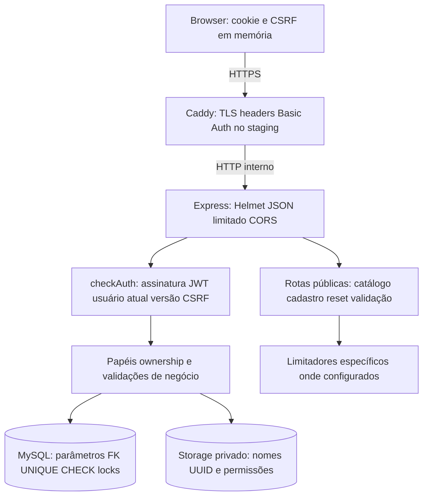

> **Histórico de engenharia.** Este registro preserva decisões e resultados da época; para desenvolver ou operar, use a [documentação vigente](../index.md).

# Segurança, arquivos e privacidade técnica

## Fronteiras e controles existentes

| Controle implementado | Evidência | Limite observado |
| --- | --- | --- |
| JWT em cookie plataforma_session | `src/config/session.js` | HttpOnly; Secure só NODE_ENV=production; SameSite=Lax, path=/, sem Domain; TTL 8 h padrão, configurável 5 min–7 dias. |
| Revogação por versão | `auth.models.js`, `checkAuth.middleware.js` | Logout invalida todos os dispositivos. Token roubado permanece válido até expiração/revogação; banco é dependência por requisição. |
| Papel atual no banco | `buscarUsuarioSessao` e checkAuth | Claim tipo não é autoridade final; cookie tem precedência sobre Bearer. |
| CSRF | checkAuth + `src/public/js/auth.js` | Mutações autenticadas por cookie exigem token vinculado ao JWT, comparado com timingSafeEqual. Bearer e rotas públicas não passam pelo gate. Não há checagem explícita de Origin no login. |
| Senhas e reset | `usuarios.models.js`, `auth.models.js` | Bcrypt 10 em cadastro/troca, 12 em reset; mínimos de força na rota. Reset SHA-256, prazo, uso único e transação. Não há MFA encontrado. |
| Autorização e IDOR | middlewares, controllers e services de domínio | Próprio aluno, professor da turma, ADMIN; testes exercitam IDs alheios. Checagens prévias à transação podem ficar obsoletas durante mudança concorrente de responsável/estado. |
| SQL injection | Queries com placeholders e colunas dinâmicas em allowlists | Não há interpolação de valores do usuário nas queries auditadas; SQL administrativo/migrations usa caminhos distintos. Não é declaração de invulnerabilidade. |
| XSS | `security-utils.js`, uso de textContent/createTextNode, CSP | Scripts same-origin e sem inline; object-src none; frame-src limitado. style-src permite unsafe-inline e Google Fonts; CSP pode ser configurada report-only. |
| URLs externas | `toSafeUrl` compartilhado com backend | Apenas mesma origem ou https://www.youtube.com; sem javascript/data/credenciais. VIDEO exige embed. LINK não é link externo irrestrito. |
| Rate limiting | `index.js`, auth.routes, `emailVerificationRateLimit.middleware.js`, detector/indexed middleware, certificados | Login 20/15 min padrão; recuperação 5/15 min; reset 10/15 min. Envio de código: 20/IP e 5/identidade por 15 min; confirmação: 60/IP e 10/identidade por 15 min. A identidade usa hash do e-mail normalizado. Stores são locais ao processo, sem compartilhamento entre réplicas. |
| HTTP/proxy | Helmet, Caddy, trust proxy=1 em production | App/db não publicam portas em Compose. Uma rede backend compartilhada, com saída, não é isolamento entre serviços internos. A topologia de um proxy deve ser preservada para confiar em IP. |
| Erros e logs | Handler final e logger | Resposta 500 geral e login são opacos para falhas inesperadas; health ADMIN ainda tem caminho que retorna error.message. Logger redige chaves, CPF/e-mail/tokens, mas não é coletor central. |
| Segredos por configuração | `env.js`, `.env.*.example`, `.dockerignore`, Compose | Produção valida nomes obrigatórios e JWT mínimo 32 caracteres. Não há secret manager; valores entram no ambiente de containers e podem ser acessados por operadores do host. Nenhum valor é publicado nesta documentação. |

O header CORS não substitui CSRF/autorização. CORS usa lista configurada ou false e não habilita credentials explicitamente; o cliente efetivo é same-origin. HTTPS atual, rotação de segredo, permissões de host, firewall real e validade de certificados remotos não foram testados nesta baseline.

## Lacunas concretas de segurança

1. **E-mail (D-01/D-02/D-15 resolvidos em 07/09/2026):** cadastro passou a criar verificação pendente atomicamente; login exige confirmação explícita; reenvio não desconfirma; endpoints reais têm limites por IP/identidade; Resend exige `{data.id,error:null}` e tem tratamento de erro/exceção/timeout. A resposta de reenvio e a recuperação permanecem genéricas. Limitações restantes: códigos persistem legíveis, os limitadores são por processo e a rota separada de disponibilidade cadastral continua informando disponibilidade de e-mail/CPF, preservada por não ser necessária à correção do fluxo.
2. **Erros, health e métricas:** login, middleware global e controllers auditados não devolvem `error.message` em 5xx; mensagens técnicas ficam nos logs com redação e request-id. `/healthz` e `/readyz` expõem somente estado mínimo. Health/métricas detalhados exigem ADMIN e não incluem senha, JWT, headers, body, path privado ou PII.
3. **Legado de análise:** `/api/plagio/analisar` ainda é roteado, persiste trecho e devolve `bruto` do motor, sem a validação de resposta restrita dos gateways novos. Feature flag reduz exposição quando desligada.
4. **Uploads:** materiais exigem extensão/MIME/%PDF-, terminador e leitura estrutural de páginas por `pdf-lib` em worker com timeout de 10 s e até duas validações simultâneas. PDFs criptografados são recusados. Não há sanitização/antivírus nem limite específico de frequência para upload de material autenticado. Validação pública de certificado armazena até 10 MiB padrão por requisição em memória, multiplicável por concorrência, e usa apenas SHA-256.
5. **Atomicidade de autorização:** várias operações conferem ownership/ENCERRADA no controller e depois escrevem no model; upload revalida, mas não é padrão uniforme. Registrar risco de corrida, sem afirmar exploração reproduzida.
6. **Integridade de arquivo:** hash persiste, mas downloads de material/certificado não recalculam os bytes antes de servir. Código público continua validando registro se o arquivo desaparecer; o verificador operacional é separado.

Esses pontos são controles incompletos ou riscos identificados por leitura, não resultados de pentest externo. Recomendações priorizadas estão em [riscos](09-risks-technical-debt.md).

## Arquitetura dos arquivos

| Classe | Local e identidade | Acesso e ciclo de vida | Backup |
| --- | --- | --- | --- |
| Materiais novos | MATERIAL_STORAGE_DIR; padrão storage/materials; Compose /app/storage/materials | UUIDv4.pending → UUIDv4.pdf; metadados ArquivosMateriais, SHA-256 dos bytes finais, nome original só apresentação. Leitura por conteúdo e autorização. Substituição cria novo ativo. | Volume material_uploads, tar.gz separado. |
| Materiais legados | src/public/assets/materiais/nome.pdf | Bloqueio Express antes de static; rota autenticada exige basename seguro, caminho exato e existência. Há PDFs de exemplo no repositório. | Integram fonte/imagem; não integram automaticamente tar do storage novo. |
| Certificados emitidos | CERTIFICATE_STORAGE_DIR; padrão storage/certificates | UUIDv4.pdf, código público independente, SHA-256 dos bytes finais. Temporário wx, write+fsync, hard link sem sobrescrever, remoção do temporário. | Volume certificate_uploads, tar.gz e verificação banco/bytes/tamanho. |
| PDF público enviado para validação | Buffer em memória via multer.memoryStorage, limitado a 10 MiB padrão | Não persiste em storage; calcula SHA-256 no servidor, consulta certificado e zera buffer em `finally`. MIME/extensão, rate limit e partes do multipart são limitados. Não recebe hash declarado pelo visitante. | Não há arquivo a incluir. |
| Imagens institucionais, CSS, JS e HTML | src/public/assets e demais estáticos | Públicos; sem fluxo CMS/upload. | Bundle/fonte/imagem. |
| Imagens do certificado | src/assets/certificates | Incorporadas pelo gerador; não são rota estática pública direta. | Fonte/imagem. |

Configuração rejeita diretórios dentro de src/public. Resolver de storage exige UUID e pai exato, reduzindo path traversal. Nome original de material rejeita separadores/controle e tem limite de tamanho. Diretório 0700 e arquivo final 0600 são aplicados no service; multer cria temporário antes do chmod final, protegido pelo diretório. Caddy não monta os volumes privados.

**Validação de materiais PDF (Goal 12):** `multer` interrompe o arquivo ao atingir `PDF_MAX_SIZE_MB` (20 MiB padrão, configurável de 1 a 100 MiB) antes de executar o parser. O mesmo `prepararArquivoPdf` atende criação e substituição: exige bytes originais com `%PDF-`, encerramento `startxref`/`%%EOF`, offset `startxref` apontando para tabela ou stream XRef, leitura pelo `pdf-lib` com objeto inválido como erro e uma ou mais páginas acessíveis. O parser roda em worker separado, com até duas validações concorrentes, limite de heap de 256 MiB e timeout de 10 s; falha devolve 422 antes de publicar arquivo/metadados. PDF protegido por senha devolve 422: “PDF protegido por senha não é suportado.” Os bytes aceitos não são reescritos. `pdf-lib` pode recuperar certas anomalias internas e não oferece detecção robusta de JavaScript, OpenAction ou Launch; estes continuam risco residual em leitores do usuário. Antivírus permanece endurecimento futuro condicionado ao uso institucional. O backend não executa conteúdo do PDF. Downloads usam `application/pdf`, `nosniff`, nome codificado e storage privado; `safeFile` rejeita symlink, hardlink e escape de raiz.

**Consistência:** temporário privado, fsync e publicação exclusiva do final precedem INSERT/COMMIT. Autorização material permanece sob lock da turma. Falha anterior ao COMMIT tenta compensação; confirmação ambígua conserva os bytes. Reconciliador manual dry-run detecta resíduos, missing e hash mismatch; APPLY exige alvos individuais e elegibilidade. Não há transação distribuída nem limpeza automática no boot.

**Replicação:** novas linhas Conteudos compartilham id_arquivo_material sob check/lock do asset ATIVO. Remoção do último vínculo marca RETIDO; enquanto outra turma referenciar o material, ele permanece ativo. Retenção padrão de 90 dias e collector explícito controlam o crescimento sem apagar cópias ativas.

**Certificados:** revogação não reescreve arquivo, portanto um PDF antigo conserva o mesmo hash, mas a consulta responde REVOGADO. Imagem de assinatura, brasão ou nome de responsável no documento não equivale a assinatura digital criptográfica. O sistema implementa validação registral e comparação de bytes, sem PKI de assinatura documental.

## Privacidade e LGPD — análise estritamente técnica

Esta seção descreve dados e mecanismos; não emite parecer jurídico, não determina base legal e não certifica conformidade.

| Dados | Onde persistem/circulam | Exposição e lacuna |
| --- | --- | --- |
| Nome, CPF, e-mail, telefone | Usuarios; frontend autorizado; backup SQL | ADMIN e próprio usuário consultam perfil completo; professor vê nome/e-mail de alunos da turma. Sem mecanismo geral de exportação/anonimização por titular encontrado. |
| Hash de senha e tokens | Usuarios e PasswordResetTokens; backups | Hashes não são devolvidos em consultas usuais; códigos de e-mail persistem legíveis. Sem job de expurgo de tokens antigos encontrado. |
| Matrícula, nota, progresso e respostas | MySQL e áreas acadêmicas | Dados educacionais associados ao usuário; cancelamento preserva histórico; retenção temporal não definida. |
| Nome, CPF e participação no PDF | Bytes privados, snapshot_json das novas versões e cópias/backup | CPF aparece no PDF; API pública omite CPF/e-mail. Quem recebe o arquivo pode redistribuí-lo fora do sistema. |
| Nome e dados acadêmicos de certificado | Endpoint público por código/hash | Exposição intencional de aluno, curso, turma, carga e emissão; sem enumeração sequencial de código. Revogação continua publicamente identificável. |
| Texto suspeito e fontes | AnalisesPlagio; motor externo | Legado guarda texto; não aplicar afirmação “nenhum texto é armazenado” a toda plataforma. |
| Resumos contextuais | AnalisesContextuais | Contagens, severidade, parâmetros e duração; documento completo não é armazenado por esse model. Texto é enviado ao serviço externo. |
| Logs de app/proxy | stdout e destino configurado no host | Logger redige muitos dados; Caddy registra acesso, inclusive path/código público e metadados de rede. Não há prazo de retenção/centralização evidenciado. |
| Backups | Diretório escolhido pelo operador | Contêm dados pessoais, hashes e PDFs. umask 077 restringe arquivo, mas não implementa criptografia, offsite ou descarte. |
| Acesso a YouTube/Google Fonts/Resend | Browser/provedor ou backend/provedor | Dependências externas processam requisições/e-mail; política operacional dos provedores não auditada. |

Recomendações técnicas proporcionais: inventário de retenção por classe, acesso mínimo aos backups, restauração ensaiada, procedimento de atendimento a titulares compatível com histórico acadêmico, minimização de logs e revisão da exposição de CPF no documento. Regras de exclusão atuais bloqueiam usuários com vínculos: não constituem política de retenção nem processo de privacidade completo.

### Proteção de backups — Goal 08

Backups não incluem `.env`, tokens, chaves ou credenciais. Secrets de recuperação são fornecidos
separadamente. Arquivos locais usam umask 077; Blob exige TLS 1.2, criptografia at rest e container
sem acesso público. A VM autentica por identidade gerenciada, com `Storage Blob Data Contributor`
no escopo do container, sem storage key/SAS persistido. Logs registram IDs, duração, tamanho e
destinos sem connection strings. Restore recusa paths não canônicos, symlink/hardlink, formato
desconhecido, checksum divergente e target ausente antes da etapa destrutiva.

### Goal 03 — integridade e privacidade de versões

Históricos permanecem imutáveis no fluxo da aplicação: nenhuma rota troca PDF, hash, código ou snapshot, remove versão ou reativa documento. ADMIN reemite com motivo e autoria/data consultáveis. Revalidação acadêmica usa a mesma fonte de verdade do Goal 02; privilégios administrativos não a ignoram. Locks e constraints MySQL protegem ativo/versão/predecessor independentemente da interface.

Novo snapshot_json privado inclui CPF e dados realmente usados no PDF, responsável, conteúdos e requisitos acadêmicos. Não é devolvido pelos serializers de download/listagem/histórico nem pela API pública. Código público e QR continuam aleatórios e sem dados pessoais embutidos; o validador mostra apenas os campos públicos existentes e versão. Storage privado, UUID, SHA-256, download autenticado, ownership, CSRF e rate limits permanecem. Backups mantêm DB e todos os PDFs, inclusive revogados; replicação continua excluindo Certificados e arquivos/histórico. Sem assinatura do emissor ou nova infraestrutura de auditoria.

## Atualização — Goal 06

Proteção TOCTOU de autoria implementada com locks de linha MySQL, válida entre processos Node. ADMIN não ignora encerramento, pertencimento ou histórico. Alteração administrativa de professor/status/curso disputa a mesma linha. Não há cache autoritativo, mutex global, rate limit como exclusão mútua ou alteração global de isolamento.

Contrato, inventário e evidências: [GOAL_06_ATOMIC_ACADEMIC_AUTHORIZATION.md](goals/GOAL_06_ATOMIC_ACADEMIC_AUTHORIZATION.md).

## Storage e reconciliação — Goal 07

O reconciliador recusa symlinks, paths não canônicos, arquivos inesperados e namespaces sobrepostos. APPLY exige UUIDs individuais revisados, com revalidação de referências e locks. PDFs de certificados têm barreira explícita contra purge. JSON/logs omitem dados pessoais e conteúdo. [Contrato, inventário e evidências](goals/GOAL_07_STORAGE_DATABASE_INTEGRITY.md).
