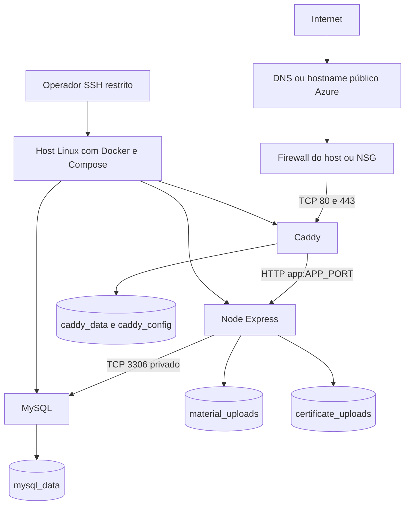

> **Histórico de engenharia.** Este registro preserva decisões e resultados da época; para desenvolver ou operar, use a [documentação vigente](../index.md).

# Execução, infraestrutura, entrega e recuperação

## Ambientes e evidência

| Ambiente | Configuração/caminho | Estado comprovado e limites |
| --- | --- | --- |
| Local | Node, npm, MySQL configurado por .env; npm start/dev executam index.js | Código e comandos auditados. Em 06/09 houve MySQL de teste acessível; em 07/09 reconsulta recusada por ECONNREFUSED. Sem mudança de serviço. |
| Testes | `.env.test` autocontido; banco descartável nome exato em 127.0.0.1:33307 | MySQL real e isolamento sequencial; nenhum fallback para `.env`/3306 no endpoint do banco. |
| CI | GitHub Actions ubuntu-latest, Node 20 e MySQL 8.4 | Workflow lido; execução remota atual não consultada. Não afirmar CI remoto verde com base nos testes locais. |
| Staging/demo | Compose base + override, APP_ENV=staging e NODE_ENV=production | Revalidado remotamente em 18/09/2026 no Goal 11B: containers saudáveis, HTTPS/health/readiness/métricas OK, MySQL 8.4.11, migration 013 aplicada e NO-OP posterior. O app lê o latest-good local do mesmo diretório do timer diário (`/var/backups/plataforma-cursos`); a última execução do timer falhou em 18/09 às 06:15 UTC, antes do deploy final, e exige acompanhamento da próxima execução. |
| Produção | .env.production.example, Compose base e DEPLOY_VPS | Preparação e procedimento existentes; **não há evidência suficiente de produção institucional ativa**. Não confundir NODE_ENV=production do staging com produção de negócio. |

A configuração real está em `Dockerfile`, `compose.yaml`, `compose.staging.yaml`, `Caddyfile*`, `.github/workflows/ci.yml` e scripts. O histórico operacional apoia contexto, sem substituir checagem da implantação atual. O Goal 11A atualizou a imagem da aplicação e o contrato do banco sem reprovisionar a VM nem recriar o banco; a evidência operacional datada está registrada abaixo.

## Topologia de implantação

| Serviço | Imagem/execução | Portas e rede | Persistência | Saúde/restart |
| --- | --- | --- | --- | --- |
| db | mysql:8.4 | 3306 só dentro da rede backend; sem ports no host | mysql_data → /var/lib/mysql; schema.sql read-only em initdb | mysqladmin ping 10 s, timeout 5 s, 12 tentativas, start 30 s; unless-stopped |
| app | Build Node 20 bookworm-slim, usuário node | `APP_PORT` compartilhada, padrão 3000; sem ports no host | materials, certificates e backup status read-only | `/readyz` 30 s, timeout 5 s, 3 tentativas, start 20 s; aguarda db healthy; unless-stopped |
| caddy | caddy:2.8-alpine | Publica 80 TCP, 443 TCP e 443 UDP; backend | Caddyfile ro; caddy_data /data e caddy_config /config | Aguarda app healthy; unless-stopped; override adiciona teste local :2019/config/ |

`backend.internal=false` permite egress; não é uma rede air-gapped. Não existe serviço Redis, broker, motor-ia, object storage ou balanceador no Compose auditado. Node, healthcheck e `reverse_proxy app:{$APP_PORT}` recebem o mesmo `APP_PORT`; `PORT` não é reconhecida. UDP 443 está no Compose, mas script NSG cria regras TCP 22/80/443; não presumir HTTP/3 acessível no Azure.

Dockerfile instala dependências com `npm ci --omit=dev` em estágio separado, copia código/SQL/scripts específicos e usa USER node. Não copia arquivo .env na imagem. Versões de imagens são tags, não digests imutáveis. Configuração de produção valida conexão/JWT/URL e, conforme flags, e-mail/motor.

## TLS, staging e Azure

Caddy recebe APP_DOMAIN/APP_PORT e gerencia TLS/ACME conforme sua configuração padrão. Adiciona HSTS, nosniff, política de referrer, compressão e logs JSON. Staging adiciona Basic Auth a tudo exceto healthz/readyz e X-Robots-Tag noindex. O healthcheck de Caddy no override testa a API administrativa local, não o domínio HTTPS ou a aplicação fim a fim.

`scripts/provision_azure_staging.sh` descreve grupo de recursos, VNet/subnet, NSG, IP Standard estático, NIC e VM Ubuntu 24.04 com chave SSH, disco StandardSSD_LRS 32 GiB. Defaults de região/SKU são configuráveis. `docs/engineering/history/AZURE_STAGING.md` relata que a implantação efetiva usou outra região/SKU (Chile Central, B2als_v2, 2 vCPU/4 GiB), divergência explicada pela disponibilidade da assinatura; não são requisitos permanentes. `bootstrap_azure_vm.sh` instala Docker Engine/Compose plugin e prepara /opt/plataforma-cursos. Não há AKS, banco gerenciado ou Blob Storage nessa topologia.

O runbook registra Let's Encrypt, saúde após reinício, smoke e backup em datas anteriores. O rollout do Goal 11A acrescenta verificação remota datada de 17/09/2026; não equivale a monitoramento contínuo. IPs, credenciais, identidade de assinatura e hashes de Basic Auth foram deliberadamente omitidos deste baseline.

## Pipeline atual

1. **Local:** npm ci → lint → Jest → integração (MySQL descartável) → build. `npm run build` verifica presença/conteúdo dos artefatos, não transpila JS/CSS nem constrói imagem.
2. **CI:** push/PR → checkout/setup Node20/npm ci → espera MySQL8.4 → habilita triggers → verifica sintaxe/isolamento/parser/checksums → `db:migrate` sobre banco vazio → status + validator completo → seed → `test:all` uma vez → docker build. O workflow usa secrets CI para conexão e senha de seed. Não há publicação de imagem ou deploy automático no YAML.
3. **Empacotamento:** `package_staging_bundle.sh` inclui código/scripts/SQL/docs/README/configs de staging e devolve SHA-256 e revisão-base. Worktree sujo exige identidade do bundle/árvore além do commit. Não publica nada sozinho. Arquivos sensíveis não devem ser colocados dentro das áreas incluídas.
4. **Deploy manual por script:** valida Docker/ambiente/config, constrói imagem e sobe db; roda status/checksum somente leitura; captura backup quando há banco corrente; executa apenas migrations pendentes sob lock; valida schema completo; continua com bootstrap/seed configurados, stack, health e histórico. Drift interrompe antes de DDL.
5. **Homologação:** `smoke_staging.js`, `smoke_certificates_staging.js`, validações learning-path e capturas são comandos externos separados. Alguns escrevem matrículas/conclusões/certificados de demonstração; não são healthchecks somente leitura e não foram executados contra servidor remoto nesta auditoria.
6. **Rollback:** runbook orienta voltar código/imagem compatível ou restaurar backup em janela controlada se schema incompatível. Script não faz rollback automático, blue/green ou atualização sem indisponibilidade.

Migrations usam ledger/checksum e `GET_LOCK`, são forward-only e não anunciam rollback de DDL. Falha parcial não entra no ledger nem permite seguir. Initdb só popula volume novo; trocar schema.sql não atualiza volume existente. Banco persistente pré-ledger exige baseline manual validado; veja [DATABASE_MIGRATIONS.md](history/DATABASE_MIGRATIONS.md). `loadEnvironment` e execução fora da imagem continuam exigindo atenção à precedência de ambiente.

## Contratos de configuração (nomes, nunca valores)

| Grupo | Nomes relevantes |
| --- | --- |
| Execução e identidade | NODE_ENV, APP_ENV, APP_PORT, APP_DOMAIN, APP_BASE_URL, APP_NAME |
| Banco/pool | DB_HOST, DB_PORT, DB_NAME, DB_USER, DB_PASSWORD, MYSQL_ROOT_PASSWORD, DB_POOL_MAX, DB_POOL_QUEUE_LIMIT, DB_POOL_WAIT_FOR_CONNECTIONS, DB_CONNECT_TIMEOUT_MS |
| Sessão/limites | JWT_SECRET, SESSION_TTL_SECONDS, AUTH_RATE_LIMIT_MAX, PASSWORD_RESET_TTL_MINUTES, PASSWORD_RECOVERY_RATE_LIMIT, PASSWORD_RESET_RATE_LIMIT |
| Navegador | CORS_ORIGIN, CSP_REPORT_ONLY |
| Operação | SLOW_REQUEST_MS, DEFAULT_PAGE_SIZE, MAX_PAGE_SIZE, DISK_WARNING_PERCENT, DISK_CRITICAL_PERCENT, BACKUP_STATUS_DIR, RPO_HOURS |
| E-mail | EMAIL_DELIVERY_ENABLED, RESEND_API_KEY, MAIL_FROM |
| Detector | DETECTOR_ENABLED, IA_ANALISE_URL, IA_ANALISE_TIMEOUT_MS, DETECTOR_API_URL, DETECTOR_API_TIMEOUT_MS, DETECTOR_API_TIMEOUT_INCREMENTAL_MS, DETECTOR_API_TIMEOUT_COMPLETE_MS, MOTOR_IA_API_URL, MOTOR_IA_INTERNAL_API_TOKEN |
| Indexação/gateway | RETRIEVAL_API_TIMEOUT_MS, RETRIEVAL_MAX_RESPONSE_BYTES, RETRIEVAL_MAX_QUERY_CHARACTERS, RETRIEVAL_TOP_K_MAX; não são todos repassados pelo Compose base |
| Materiais/certificados | MATERIAL_STORAGE_DIR, PDF_MAX_SIZE_MB, CERTIFICATE_STORAGE_DIR, CERTIFICATE_UPLOAD_MAX_SIZE_MB, CERTIFICATE_PUBLIC_RATE_LIMIT_MAX, CERTIFICATE_UPLOAD_RATE_LIMIT_MAX, CERTIFICATE_RATE_LIMIT_WINDOW_MS |
| Texto do certificado | CERTIFICATE_INSTITUTION_NAME, CERTIFICATE_CAMPUS, CERTIFICATE_RESPONSIBLE_ROLE |
| Operação | INITIAL_ADMIN_*, STAGING_DEMO_PASSWORD, STAGING_BASIC_AUTH_USER, STAGING_BASIC_AUTH_HASH, ACME_EMAIL, COMPOSE_ENV_FILE, COMPOSE_OVERRIDE_FILE, BACKUP_DIR |

Confirmações de migration/bootstrap/restore são barreiras dos scripts operacionais, não autorização dada por este documento para executar tais ações.

O rollout inicial do Goal 11A foi executado no staging em 17/09/2026: backup offsite GOOD validado, preflight estrutural sem drift, baseline 001–011, aplicação normal da 012, segundo migrate NO-OP, validator completo e health interno/externo. A comparação com o backup confirmou dados de domínio e storages inalterados. [Evidência](evidence/goal11a-staging-validation.json).

## Backup e recuperação

`scripts/backup_database.sh` cria conjunto v1 com UUID, dump `--single-transaction`, metadata de 19 tabelas, storage privado, manifesto e SHA-256 por arquivo. A aplicação é parada durante a captura e o purge APPLY disputa a trava `plataforma:backup-storage`; depois dos bytes copiados, o app volta antes do hashing. Só conjunto verificado recebe `LOCAL_GOOD`; offsite validado publica `complete.json` e permite atualizar latest-good. Retenção padrão: 7 dias local e 30 offsite, sempre preservando o último GOOD.

`plataforma-backup.timer` executa diariamente às 03:15 `America/Sao_Paulo`, com `Persistent=true`; o service exige offsite e `flock` impede sobreposição. Logs sanitizados ficam no journal. `backup_status.sh` mede idade local/remota e retorna `RPO_AT_RISK` acima de 24 horas.

`restore_database.sh` faz dry-run por padrão. Antes de qualquer alteração valida formato, manifesto, todos os hashes, marker, gzip, espaço, secrets externos, target, Compose e MySQL. APPLY in-place para o app, recria o banco sem misturar dados, substitui os storages e só reinicia após schema, contagens, certificados/materiais byte-identical, permissões/proprietário, reconciliador DRY-RUN e health. `restore_drill.sh` usa project/volumes descartáveis, baixa o offsite novamente, mede etapas e remove a stack. O ensaio autenticado revalidado em 14/09/2026 (15/09 UTC) observou RTO de 50 s. [Runbook](history/BACKUP_RESTORE_RUNBOOK.md) e [evidências](goals/GOAL_08_BACKUP_RESTORE_DISASTER_RECOVERY.md).

## Dependências externas e criticidade

| Dependência | Finalidade/estado | Criticidade | Fallback implementado |
| --- | --- | --- | --- |
| MySQL | Fonte de verdade obrigatória | Crítica para sessão/dados | Healthz 503/startup falha; sem banco alternativo |
| Filesystem/volume local | PDFs obrigatórios após emissão/upload | Crítica para bytes; registros podem existir sem arquivo | 503 controlado em bytes privados ausentes; reconciliação e restore operacional |
| Resend | Envio por SDK integrado; staging/produção podem desabilitar explicitamente | Crítica para entrega de verificação/reset | Com entrega desabilitada, cadastro falha antes de gravar e reset mantém resposta genérica sem criar token. |
| Motor IA | APIs externas de comparação/contexto/indexação | Crítica só para detector | Flag desabilita e informa indisponibilidade; sem inferência local no Node |
| YouTube | Player embed no browser | Conteúdos de vídeo | Mensagem/links da UI; sem cópia offline automática |
| Google Fonts | Tipografia do browser | Baixa | Famílias locais/system-ui/serif no CSS |
| ACME/DNS | Obtenção e renovação TLS | Crítica para acesso público HTTPS a longo prazo | Persistência Caddy; sem processo alternativo configurado |
| Azure | Host demo conforme runbook | Crítica para instância hospedada | Compose portável para outra VPS, migração não automatizada |
| npm e registries Docker | Dependências/build | Crítica na entrega, não por requisição | Lockfile npm; sem mirror/registry próprio encontrado |
| bcrypt/JWT/Helmet/multer/mysql2/pdf-lib/qrcode | Bibliotecas críticas locais | Segurança, dados e documentos | Testes/lockfile; sem auditoria atual de vulnerabilidades nesta baseline |

Não foi feito levantamento de preços, CVEs ou estado comercial de provedores; as dependências foram identificadas no código e arquivos de entrega, sem recomendação de compra.

## Storage e reconciliação — Goal 07

Os volumes material_uploads e certificate_uploads incluem temporários e versões históricas; Caddy não os monta. Startup e readiness verificam acesso básico, sem scan; healthz não toca dependências. Reconcile é CLI manual, dry-run padrão, retenção 90 dias e carência 48 horas. [Contrato, inventário e evidências](goals/GOAL_07_STORAGE_DATABASE_INTEGRITY.md). O runbook de runtime está em [RUNTIME_OPERATIONS.md](history/RUNTIME_OPERATIONS.md).
